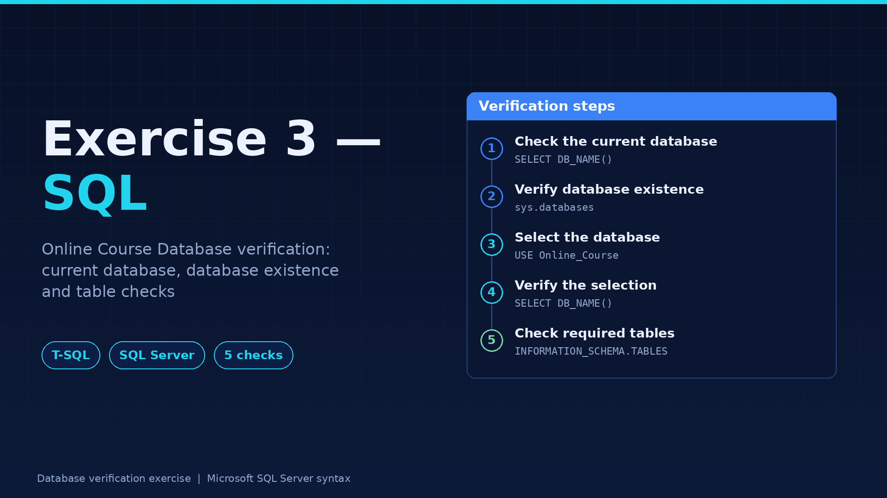
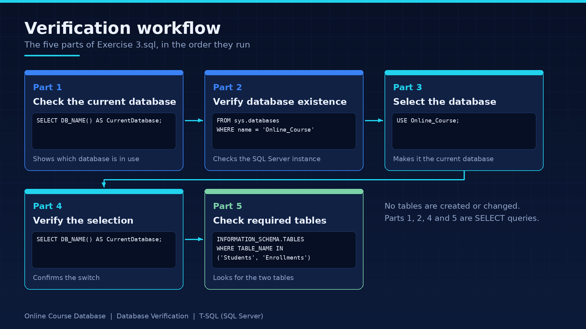
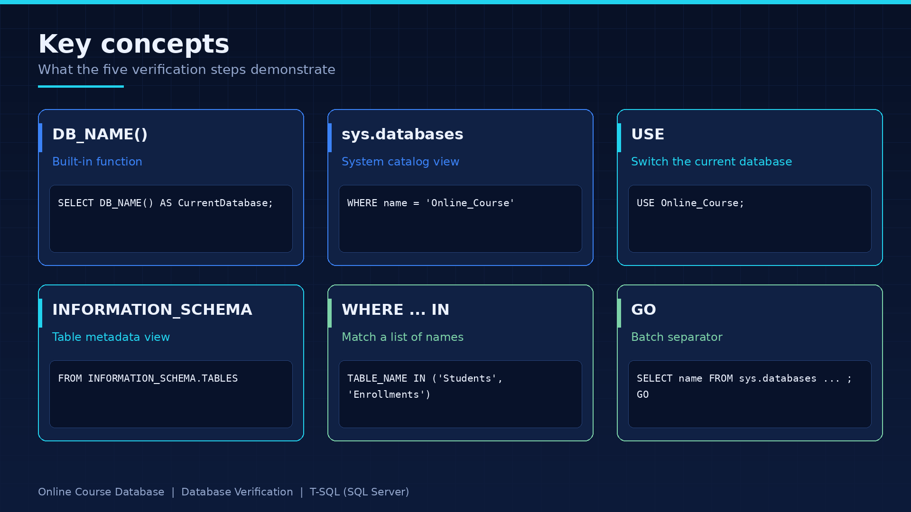
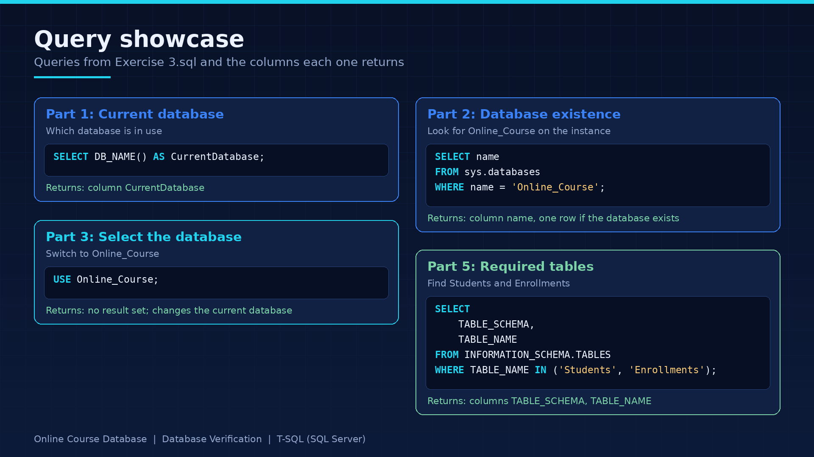

# SQL Practice — Exercise 3: Online Course Database



## Overview

This project is a SQL Server practice exercise focused on relational database creation, data manipulation, and querying.

The **Online Course Database** contains student information and course enrollment records. Through this exercise, I practiced writing SQL queries to retrieve, filter, sort, group, and analyze structured data.

The project demonstrates how SQL can be used to answer practical questions about students, academic performance, and course enrollments.

## Objectives

- Create a database and define relational tables.
- Use primary keys and foreign key constraints.
- Insert sample records into database tables.
- Filter and sort records using SQL conditions.
- Retrieve unique values using `DISTINCT`.
- Apply aggregate functions to summarize data.
- Group records and filter grouped results.
- Use subqueries to solve more complex data retrieval problems.

## Tools & Technologies

- **Microsoft SQL Server**
- **SQL Server Management Studio (SSMS)**
- **Transact-SQL (T-SQL)**

## Project Structure

```text
Exercise 3/
├── images/
│   ├── exercise-3-banner.png
│   ├── exercise-3-workflow.png
│   ├── exercise-3-concepts.png
│   └── exercise-3-showcase.png
├── Exercise 3.sql
├── .gitignore
└── README.md
```

## Database Design

The database is named `Online_Course` and contains two related tables.

### 1. Students

Stores information about students, including their names, ages, cities, and GPAs.

| Column | Description |
|---|---|
| `StudentID` | Primary key identifying each student |
| `FirstName` | Student's first name |
| `LastName` | Student's last name |
| `Age` | Student's age |
| `City` | Student's city |
| `GPA` | Student's grade point average |

### 2. Enrollments

Stores information about students' course enrollments, including course names, grades, fees, and semesters.

| Column | Description |
|---|---|
| `EnrollmentID` | Primary key identifying each enrollment |
| `StudentID` | Foreign key referencing `Students` |
| `CourseName` | Name of the course |
| `Grade` | Grade received in the course |
| `Fee` | Course fee |
| `Semester` | Semester of enrollment |

### Relationship Between Tables

The `StudentID` column in `Enrollments` references `StudentID` in `Students`.

This foreign key relationship connects each enrollment record to an existing student and helps maintain referential integrity.

## SQL Workflow



The script follows these steps:

1. Create the `Online_Course` database.
2. Select the database using `USE`.
3. Create the `Students` and `Enrollments` tables.
4. Define the primary and foreign key constraints.
5. Insert sample student and enrollment records.
6. Execute SQL queries to retrieve and analyze the data.

## SQL Queries & Explanations

### 1. Filtering Students Using `WHERE`

Retrieve students whose GPA is greater than 3.00.

```sql
SELECT FirstName, LastName, Age, GPA
FROM Students
WHERE GPA > 3.00;
```

**Explanation:**

- `SELECT` specifies the columns to retrieve.
- `FROM Students` identifies the source table.
- `WHERE` filters records based on the GPA condition.

**Expected result:** Only students with a GPA above 3.00 are returned.

### 2. Combining Conditions with `AND` and `OR`

Retrieve students who live in Cairo or Giza and are older than 20.

```sql
SELECT *
FROM Students
WHERE (City = 'Cairo' OR City = 'Giza')
  AND Age > 20;
```

**Explanation:**

- `OR` allows either city condition to be satisfied.
- `AND` additionally requires the student's age to exceed 20.
- Parentheses make the intended condition grouping explicit.

### 3. Retrieving Unique Values with `DISTINCT`

Display each city only once, in alphabetical order.

```sql
SELECT DISTINCT City
FROM Students
ORDER BY City;
```

**Explanation:**

- `DISTINCT` eliminates duplicate city values.
- `ORDER BY` sorts the resulting city names.

### 4. Finding the Top Three Students

Retrieve the three students with the highest GPAs.

```sql
SELECT TOP (3) *
FROM Students
ORDER BY GPA DESC;
```

**Explanation:**

- `TOP (3)` limits the result to three rows.
- `DESC` sorts GPAs from highest to lowest.

### 5. Using Aggregate Functions

Calculate the average, highest, and lowest GPA across all students.

```sql
SELECT
    AVG(GPA) AS [Average GPA],
    MAX(GPA) AS [Highest GPA],
    MIN(GPA) AS [Lowest GPA]
FROM Students;
```

**Explanation:**

- `AVG()` calculates the average.
- `MAX()` returns the highest value.
- `MIN()` returns the lowest value.

These functions summarize multiple records into a single result row.

### 6. Grouping Records with `GROUP BY`

Calculate the average grade for each course.

```sql
SELECT
    CourseName,
    AVG(Grade) AS Average
FROM Enrollments
GROUP BY CourseName;
```

**Explanation:**

`GROUP BY` groups enrollment records by course, allowing `AVG()` to calculate a separate average grade for each course.

### 7. Filtering Groups with `HAVING`

Count enrollments for each course and return only courses with more than three enrollments.

```sql
SELECT
    CourseName,
    COUNT(EnrollmentID) AS [Number of Enrollments]
FROM Enrollments
GROUP BY CourseName
HAVING COUNT(EnrollmentID) > 3;
```

**Explanation:**

- `GROUP BY` creates a group for each course.
- `COUNT()` counts the enrollment records in each group.
- `HAVING` filters groups according to their aggregate results.

Unlike `WHERE`, which filters individual rows before grouping, `HAVING` filters groups after aggregation.

### 8. Using a Subquery to Compare Ages

Retrieve students whose age is greater than the average age of all students.

```sql
SELECT FirstName, LastName
FROM Students
WHERE Age > (
    SELECT AVG(Age)
    FROM Students
);
```

**Explanation:**

The inner query calculates the overall average age. The outer query then returns students whose ages exceed that value.

### 9. Comparing GPA with a City-Specific Average

Retrieve students whose GPA is greater than the average GPA of students living in Cairo.

```sql
SELECT FirstName, LastName
FROM Students
WHERE GPA > (
    SELECT AVG(GPA)
    FROM Students
    WHERE City = 'Cairo'
);
```

**Explanation:**

The subquery calculates the average GPA for students in Cairo. The outer query compares every student's GPA against that average.

The returned students are not necessarily limited to Cairo because the outer query has no city filter.

### 10. Combining Subqueries with `IN`

Retrieve students who have at least one enrollment with a grade above the overall average enrollment grade.

```sql
SELECT FirstName, LastName, GPA
FROM Students
WHERE StudentID IN (
    SELECT StudentID
    FROM Enrollments
    WHERE Grade > (
        SELECT AVG(Grade)
        FROM Enrollments
    )
);
```

**Explanation:**

1. The innermost query calculates the average grade across all enrollment records.
2. The middle query retrieves student IDs associated with grades above that average.
3. The outer query returns the names and GPAs of those students.

The `IN` operator checks whether a student's ID appears in the list returned by the subquery.

## SQL Concepts Covered



| Concept | SQL Features |
|---|---|
| Database Management | `CREATE DATABASE`, `USE` |
| Table Creation | `CREATE TABLE` |
| Constraints | `PRIMARY KEY`, `FOREIGN KEY`, `NOT NULL` |
| Data Insertion | `INSERT INTO` |
| Filtering | `WHERE`, `AND`, `OR` |
| Sorting | `ORDER BY`, `DESC` |
| Unique Values | `DISTINCT` |
| Result Limiting | `TOP` |
| Aggregate Functions | `AVG`, `MAX`, `MIN`, `COUNT` |
| Grouping | `GROUP BY`, `HAVING` |
| Nested Queries | Subqueries, `IN` |

## Project Visual Showcase



## How to Run the Project

1. Open SQL Server Management Studio (SSMS).
2. Connect to a SQL Server instance.
3. Open `Exercise 3.sql`.
4. Execute the script in the intended order.
5. Review the results in the SSMS Results grid.

**Important:** The script starts with `CREATE DATABASE Online_Course`. If the database already exists, SQL Server will return an error. Use a fresh database or handle the existing database before rerunning the script.

## Learning Outcomes

Through this exercise, I practiced:

- Designing relational tables and defining relationships.
- Inserting and retrieving structured data.
- Applying filtering and sorting conditions.
- Summarizing data with aggregate functions.
- Grouping records and filtering aggregate results.
- Writing nested queries to answer more complex questions.

This exercise strengthened my understanding of SQL Server and relational database querying.

## 👩‍💻 Author

**Youmna Zaian**

Computer Engineering Graduate | AI & Machine Learning
